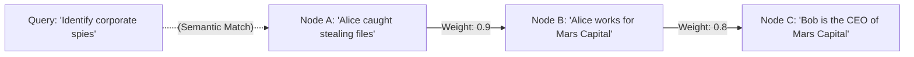

# Core Concepts

To build with the Resonant Memory Mesh, you must understand its three foundational pillars: **Nodes, Edges, and Energy Dynamics**.

## 1. Nodes: The Building Blocks

A **Node** represents a discrete chunk of information or a specific concept. In traditional terms, this is an embedding combined with its metadata.

Every node in RMM contains:
- `id`: A unique UUID.
- `vector`: A dense neural embedding (e.g., from an OpenAI or HuggingFace model).
- `metadata`: A flexible dictionary for storing text content, labels, or application-specific data.
- `significance`: A dynamic value representing how "important" this memory is. A significance of 1.0 means it is highly relevant, while a lower significance indicates a peripheral memory. High-significance nodes act as powerful energy sources during resonance.

## 2. Edges: The Reasoning Moat

An **Edge** is a directed connection between two nodes. This is where RMM diverges from standard vector databases. 

Edges give the system its topology. While you *can* connect nodes that are semantically similar, the real power of RMM lies in connecting conceptually related but semantically distinct nodes. 

Every edge has:
- `source`: The starting node.
- `target`: The receiving node.
- `weight`: The strength of the connection (between 0.0 and 1.0).

By creating edges between facts, investigations, or dialogue turns, you are explicitly teaching the RMM the causal logic of your data.

## 3. Resonance and Energy Flow

When you query an RMM, you aren't just doing a nearest-neighbor search. You are initiating an **Energy Pulse**.

1. **Initial Activation:** The system first finds the nodes that are most semantically similar to your query vector. These nodes are injected with an initial burst of "energy".
2. **Propagation:** Energy flows from the activated nodes across their outgoing edges to their neighbors. The amount of energy transmitted depends on the edge `weight` and the `significance` of the source node.
3. **Decay:** To prevent the entire mesh from lighting up, energy decays as it travels. 
4. **Result Ranking:** After the pulse settles, the system returns the nodes with the highest accumulated energy.

### The Causal Chain

This mechanism enables the **Causal Chain**, allowing the mesh to deduce connections that aren't explicitly visible through text overlap alone.

Imagine a simple intelligence database graphing the following scenario:

If you query the system with a prompt similar to **Node A** ("Identify corporate spies"), **Node A** will resonate loudly because of direct semantic similarity. 

However, **Node C** ("Bob is the CEO of Mars Capital") has absolutely zero linguistic or semantic overlap with the phrase "corporate spies". A flat Vector DB will never return Bob.

But in the Resonant Memory Mesh, if Node A is connected to Node B, and Node B is connected to Node C, the energy from Node A will rapidly propagate down the chain. **Node C** will begin to "ring" with energy, bubbling up to the top of your search results based entirely on its topological proximity to the crime.

This topological resonance is how RMM uncovers deep, deductive connections that flat databases miss. It builds a genuine "Reasoning Moat" into your memory layer.
